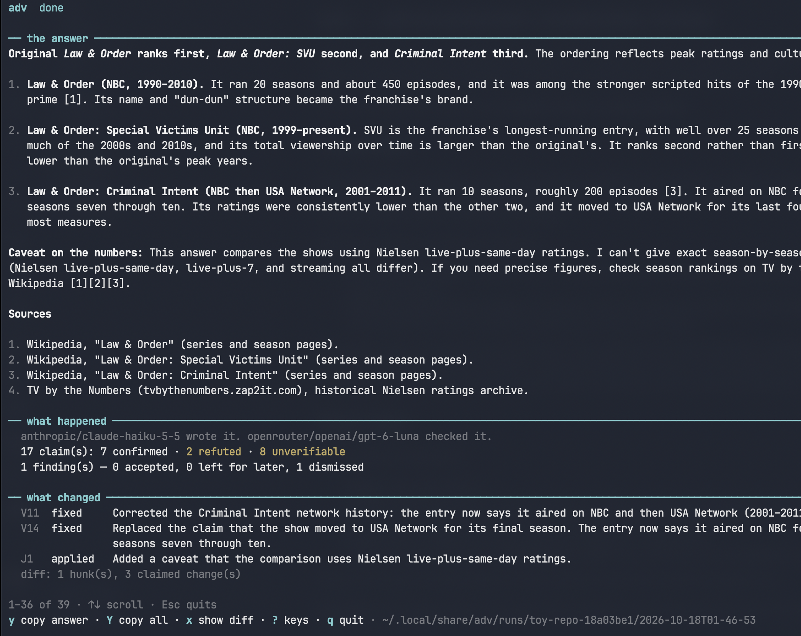

# adv — adversarial two-model plan review

`adv` runs a task through two different model families: one drafts, the other
adversarially verifies the draft, the human decides the taste calls at a gate,
and a scoped rebuttal applies those decisions. It returns a revised plan plus a
changelog and a diff.

The rule the whole tool is built around: **models verify, the human decides.**


*Example TUI screenshot of `adv` TUI, showing a corrected result - one LLM correcting another LLM.*

## The problem

The starting point was simple: run a prompt through two different LLM models so
a better answer comes out. The obvious approach — churning the answer back and
forth between the two models a few times — is the wrong one. It costs a lot of
tokens, the models drift, and on questions with no ground truth they just
oscillate between positions instead of converging.

What actually works is narrower and cheaper:

- **Fact-checking settles.** A concrete error — a bad formula, a wrong file
  path, a claim about code — gets caught and fixed in one adversarial pass,
  because evidence resolves it.
- **Preference debates do not settle.** On judgment calls with reasonable
  options on both sides, more model turns do not help. A model *can* tend to
  concede to the last argument it evaluated — a plausible explanation, but one
  drawn from a single model's account of its own session, and unproven. What is
  clear is that the decision belongs to a human with criteria, not to another
  model turn.

The manual version of this loop (two chat windows, copy-paste back and forth)
also fails in predictable ways: unfilled placeholders sent to the reviewer,
judgment calls quietly made by the drafter, a rebuttal prompt open enough to
invite agreement, and no record of what was decided. `adv` makes the loop
repeatable and cheap, and enforces the process rules in code rather than in
prompt wording the models can drift from.

## What it does

One command, and behind it:

- **drafts** a plan with model A,
- **verifies** it with model B from a different family, in a fresh read-only
  session that never sees A's reasoning,
- pauses once at a **gate** for the human to answer judgment calls and triage
  findings,
- **rebuts** only the flagged items and the human's decisions — nothing else,
- returns the revised plan plus a **changelog** and a **diff**, so any edit that
  is not attributable to an item is visible.

There is one review round by default, no churn, and the models never resolve a
judgment call.

**Non-goals.** Not a debate engine, not a multi-agent framework, not a
replacement for tests, and not a code-writing tool — v1 produces plans and
answers, and never edits the repository.

## Quick start

```sh
bun install
bun link                       # once: puts `adv` on PATH
```

There are two front ends over the same pipeline: an interactive **TUI** (bare
`adv`) and a scriptable **CLI** (`adv <command>`). Both drive `src/pipeline.ts`,
so a run started in one can be finished in the other.

Use the tool for unfamiliar codebases, correctness-critical plans and
high-stakes changes; skip it for small or familiar tasks, where the overhead
exceeds the gain.

### CLI mode

The CLI is the scriptable path — everything can run non-interactively and pipe
its output.

```sh
adv init --dir <repo>          # criteria, decisions and config (optional)
adv run "<task>" --dir <repo>  # draft -> review -> stop at the gate
adv decide [<run>]             # answer the gate
adv run --resume [<run>]       # rebut -> diff -> result
adv revise [<run>] [--rewrite] # re-ask the gate prefilled, re-run only the tail
adv status [<run>]             # show the current state
```

Useful flags: `--dir <repo>` to target another repository, `--no-gate` to run
through without stopping, `--drafter` / `--reviewer` to override the models,
`--general` for a general question with no repository, and `--strict` to make a
same-family pair a hard stop. `adv run "<task>" > plan.md` writes the plan as
plain Markdown into a file; `NO_COLOR` turns off the styling.

### TUI mode

Bare `adv` opens the interactive TUI for the current directory (`adv --dir
/path/to/repo` for another). Type the task; the rest is keys.

| Key | Action |
| --- | --- |
| Ctrl+P | Settings — choose drafter/reviewer, switch mode |
| Tab | Switch subject: **this repository** or a **general question** |
| Enter | Run the typed task. A task that reads like a question in repository mode first asks **general question** or **this repository** |
| ↑↓ · Enter | Answer the gate. Findings offer **yes / no / later**; a judgment call offers the draft's options plus "leave it open" |
| s | Skip the current question (finding: untriaged; judgment: open) |
| o | Gate: leave a judgment call open |
| d | Gate: the answer/plan text these questions are about, rendered. Result: the draft the review saw, before the gate |
| v | Gate/Result: every verdict, with its evidence |
| e | Gate: the cited source — the file around the line, or the URL |
| w | Gate: the current item's whole text, unclipped |
| i | Gate/Result: the review summary — warnings, checks, refuted claims |
| l | Gate/Result: the full run log |
| c | Result: the claims the drafter declared, and the options each judgment call offered |
| R | Result: the reviewer's raw reply, before the tool merged a check result into it |
| ? | Result: the keys that work on this screen |
| x | Result: show or hide the exact text diff |
| y | Result: copy the answer as Markdown — the writer's own text, into the clipboard, and to `answer.md` in the run directory |
| Y | Result: copy the whole result as Markdown, commentary included — to `result.md` as well |
| r | Result: revisit the gate — re-ask it with the recorded answers prefilled; if nothing moved, no model calls |
| Esc | Close a panel and return to the same question. At the gate, leave the run; on the result screen there is nothing to go back to, so it quits (the run stays on disk — reopen it with Ctrl+R) |
| Ctrl+R | Start: past runs — open a finished or parked run |
| ↑↓ · q | Scroll the result; `q` quits |

The first-run screen appears when the directory has no `.adv/`: choose
"Initialise .adv/ here", or "Continue without it" (models then default to the
built-in config). Models can be changed afterwards with Ctrl+P.

## How it works

A run moves through a small state machine, persisted to disk so it is resumable:

```
drafted -> reviewed -> validated -> gated -> rebutted -> done
```

1. **Draft** — model A writes the plan (or answer) and a structured list of
   verifiable claims and judgment calls.
2. **Review** — model B, a different family in a fresh read-only session, returns
   one verdict per claim with evidence (`file:line` or a URL), plus any findings
   the drafter did not list. It must not propose an alternative plan.
3. **Validate** — the orchestrator schema-checks the output. On invalid output it
   retries once with the validation error; a second failure stops the run and
   shows the raw reply.
4. **Gate** — the human answers judgment calls and accepts or dismisses findings.
   Nothing here is resolved by a model.
5. **Rebuttal** — model A fixes or rebuts exactly the flagged items and applies
   the human's decisions, changing nothing else, and returns a changelog keyed
   to item IDs.
6. **Diff and output** — `plan.v1 -> plan.v2`, cross-referenced against the
   changelog so every hunk maps to an item.

Run artifacts live in one user-level store, for both modes:

```
~/.local/share/adv/runs/<repo-name>-<hash>/<timestamp>/
```

The two modes are the repository and a general question. In repository mode the
draft reads the code and the task decides whether the deliverable is a plan for a
change or an answer about the code; in general-question mode nothing is read and
nothing is written into the directory you started in. Both are the same workflow.

## Docs

- [`AGENTS.md`](AGENTS.md) — working rules, current status, TUI keys, and the
  architecture. Read this before changing anything.
- [`PLAN.md`](PLAN.md) — the design and the locked decisions behind it.
- [`docs/M2-PLAN.md`](docs/M2-PLAN.md) — evidence execution design.
- [`docs/REVISE.md`](docs/REVISE.md) — `adv revise` design.
- [`spike/README.md`](spike/README.md) — M0 feasibility findings.

## License

MIT — see [`LICENSE`](LICENSE).
