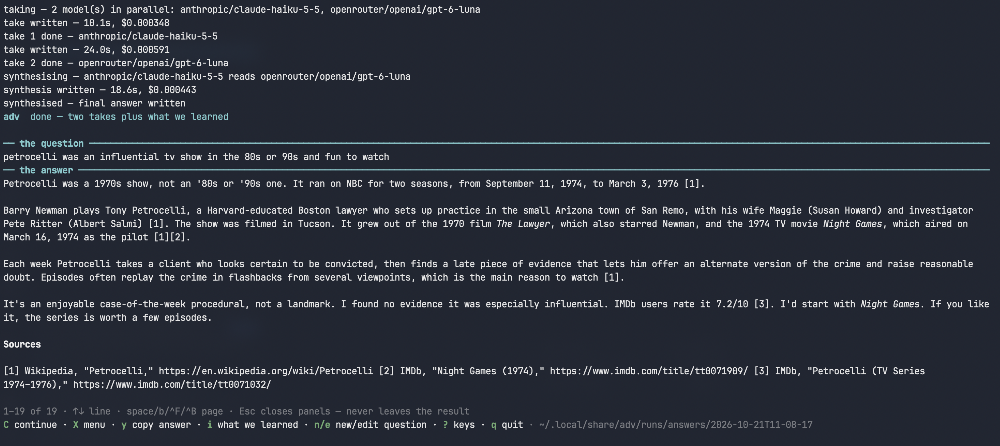
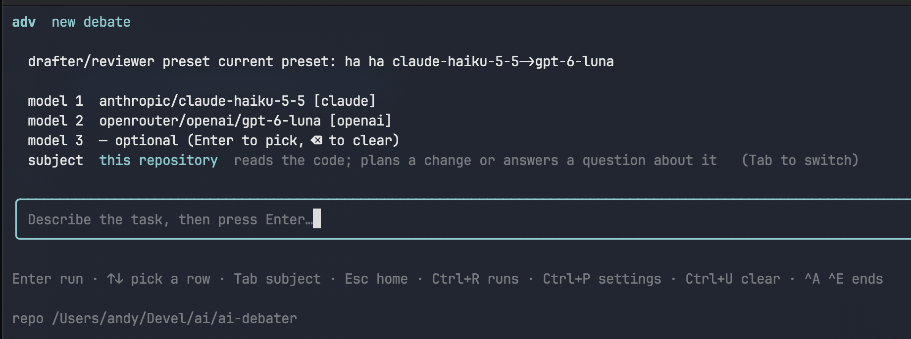
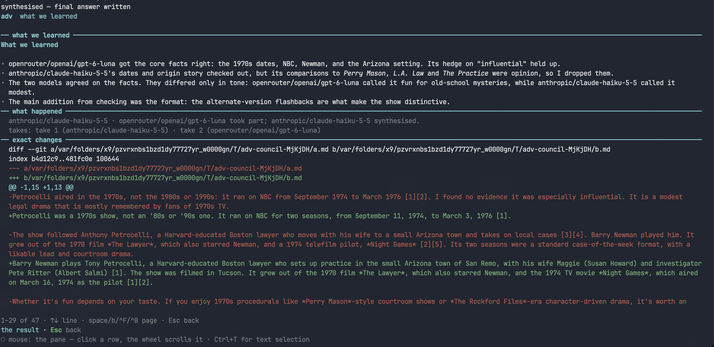
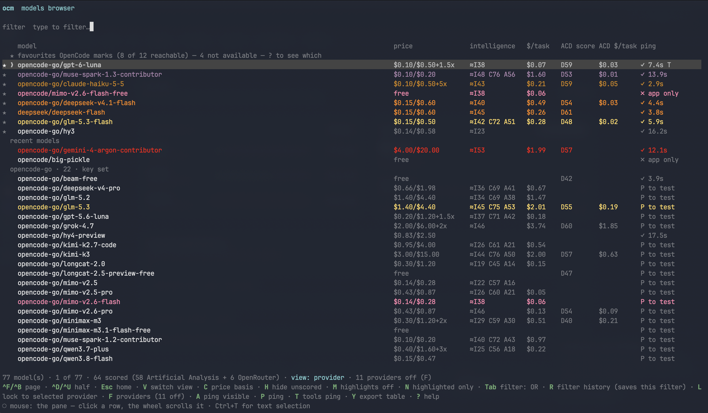
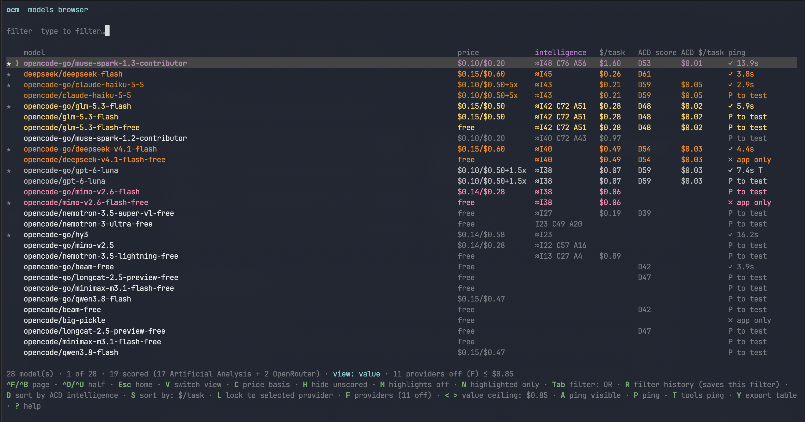

# ai-debater

Two tools that work in conjunction with the [OpenCode](https://opencode.ai)
CLI. **`adv`** asks multiple LLMs the same question and synthesises their
answers into one — each model writes its own independent take, then the lead
model reads all the takes and produces a final answer ending with a short
"what we learned" note on what the peers contributed. **`ocm`** is a model
browser showing all models available to OpenCode, ranked by price and
benchmarked AI intelligence, so you can pick the best-value models and get the
best from your OpenCode models.

The rule the whole tool is built around: **models debate, a better result comes out.**


*A finished debate: the question, the synthesised answer, and sources.*

## Better LLM results through AI debate

Churning an answer back and forth between two models is the wrong loop: it
costs a lot of tokens, the models drift, and with no ground truth they just
oscillate instead of converging. What works is narrower and cheaper:

- **Independent takes stay honest.** Each model answers the same prompt
  without seeing the others, so agreement is real signal and disagreement is
  worth reading — neither is an artefact of who spoke last.
- **One synthesis, no churn.** The lead keeps what was already right, takes
  what the peers did better, and recommends where they genuinely disagreed.
  A single pass, in parallel: wall-clock time is one take, not three.
- **You settle the rest.** The synthesis recommends; judgment calls stay with
  the human, who follows up where the models disagree.

## Requirements

- [Bun](https://bun.sh) — `adv` runs on Bun's runtime (`Bun.spawn`,
  `Bun.file`), not plain Node.
- [OpenCode](https://opencode.ai) — every model call goes through
  `opencode run`, so nothing works without it.

## Install

No npm account, no registry — install straight from GitHub:

```sh
curl -fsSL https://raw.githubusercontent.com/abulka/ai-debater/main/install.sh | sh
```

The script installs Bun if it is missing, warns if `opencode` is missing,
clones (or updates) the repo into `~/.local/share/ai-debater`, runs
`bun install`, and symlinks `adv` and `ocm` into `~/.local/bin`. Re-running it
updates an existing install. It takes `--repo`, `--dir` and `--bin` flags —
run it with `--help` to see them.

Or by hand:

```sh
git clone https://github.com/abulka/ai-debater.git
cd ai-debater
bun install
bun link                       # once: puts `adv` and `ocm` on PATH
```

## `adv` — one question, several models, one answer

One command, and behind it:

- **takes** — two or three models answer the same prompt independently and in
  parallel, each read-only, none seeing the others;
- **synthesis** — the lead model reads every take and writes the final answer,
  keeping what was right, taking what the peers did better, and ending with a
  **what we learned** note naming each model by ref.

One pass. The `x` key shows the diff from take 1 to the final answer, so what
the synthesis changed is visible.


*The new-debate desk: preset, models, subject, and the prompt.*


*The `i` panel: what each take contributed, what happened, and the exact changes.*

**Non-goals.** Not a multi-agent framework, not a replacement for tests, and
not a code-writing tool — it produces plans and
answers, and never edits the repository.

There are two front ends over the same pipeline: an interactive **TUI** (bare
`adv`) and a scriptable **CLI** (`adv <command>`).

Use the tool for unfamiliar codebases, correctness-critical plans and
high-stakes questions; skip it for small or familiar tasks, where the overhead
exceeds the gain.

Bare `adv` opens the interactive TUI for the current directory. Home first —
models browser, new debate, past runs, settings — then keys. Every screen
lists its own keys behind `?`; the essentials:

| Key | Action |
| --- | --- |
| ↑↓ · Enter | Choose a model pair or preset; on the prompt, run the typed task |
| Tab | Switch subject — **this repository** or a **general question** |
| y / Y | Copy the answer / the whole result as Markdown |
| x | Diff from take 1 to the final answer |
| i | What we learned |
| C | Continue this debate with a follow-up |

More keys, the full CLI reference, and how runs are stored:
[`docs/USAGE.md`](docs/USAGE.md).

## `ocm` — the model browser

`ocm` shows every model OpenCode knows, with live price, benchmarked
intelligence, measured cost per task, and reachability — ranked so the best
value is easy to spot. Ping a model (`P`) to settle whether your key can
actually call it; results are cached and shown with their age. No run is
started, no question is asked. The same browser is also inside `adv` — home
first, then `m`.


*Provider view: favourites first, with price, benchmarks, measured cost and ping status.*


*Value view: the same models ranked by measured cost, cheapest first.*

Detail — views, ping depths, and which models will actually work:
[`docs/USAGE.md`](docs/USAGE.md).

## How it works

A run moves through `created -> taking -> synthesizing -> done`, persisted per
run under `~/.local/share/adv/runs/`. Full detail:
[`docs/USAGE.md`](docs/USAGE.md).

## Docs

- [`docs/USAGE.md`](docs/USAGE.md) — CLI reference, TUI keys, run storage,
  the model browser.
- [`AGENTS.md`](AGENTS.md) — working rules for contributors and agents.
- [`docs/BENCHMARKS.md`](docs/BENCHMARKS.md) — benchmarks in the picker.
- [`docs/OPENCODE-MODELS.md`](docs/OPENCODE-MODELS.md) — why `opencode
  models` is candidates, not availability, with the reproduction.

## License

MIT — see [`LICENSE`](LICENSE).
